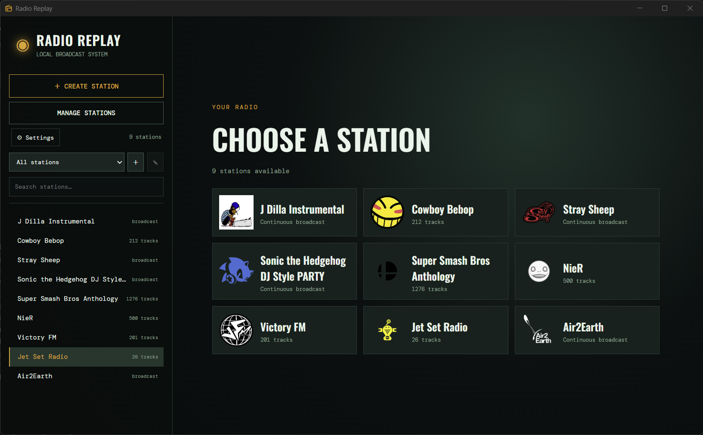
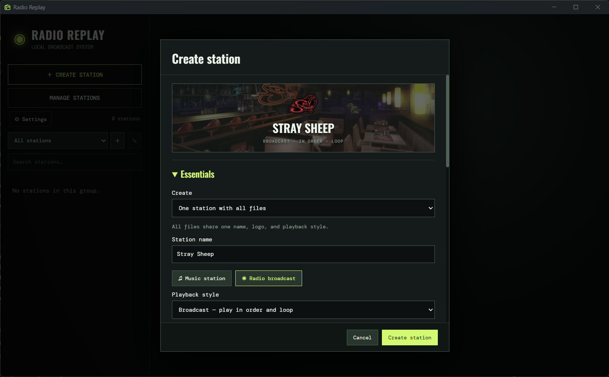
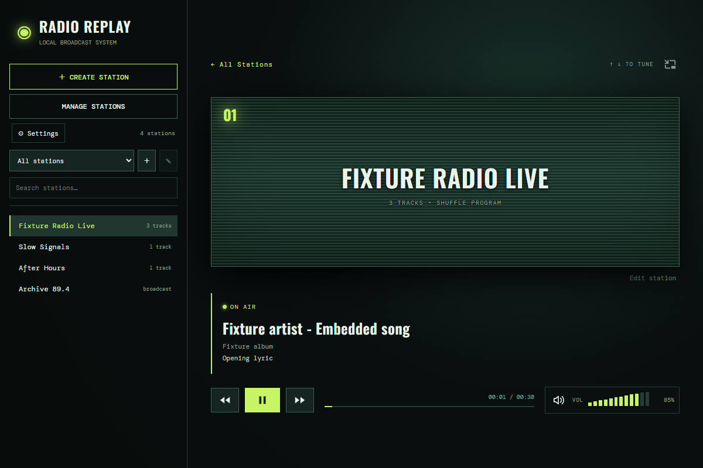
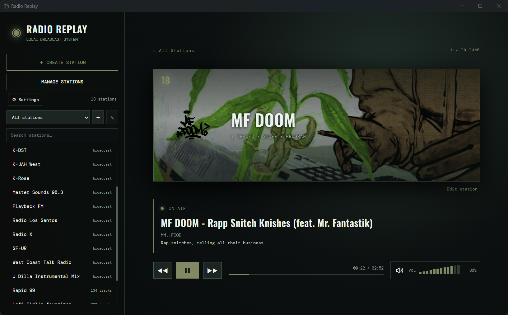

# Radio Replay

Radio Replay turns your own audio collection into a desktop radio experience. Create shuffled music stations, tune into complete radio recordings, organize stations into groups, and give each one its own artwork and visual style.

The player is inspired by the station tuning found in games such as Grand Theft Auto, but it includes no game audio, music, artwork, or other copyrighted game assets. You supply the audio you want to play.

> [!IMPORTANT]
> This app was made heavily with the assistance of AI. If you don't like it, don't use it.

<p align="center">
  
    
</p>
<p align = "center">
    
      
</p>

## Download

Ready-to-run Windows, Linux, and macOS builds are attached to each project release. Download the build for your system from the [Releases page](../../releases) and run Radio Replay.

Release builds include everything required to use the app. You do not need Node.js, npm, or a development environment unless you want to build Radio Replay from source.

> [!WARNING]
> Release builds are currently unsigned. Windows may show a SmartScreen warning, and macOS may require you to approve the app in Privacy & Security before opening it for the first time.

## Major features

- Create stations from individual audio files or an entire folder.
- Shuffle a collection as a music station or play long recordings in order as a radio broadcast.
- Keep station timelines moving while you listen elsewhere, giving each station the feel of a continuous broadcast.
- Organize whole stations or selected tracks into custom groups.
- Add station logos, animated GIFs, background images, colors, and accent colors.
- Display embedded track information and synchronized `.lrc` lyrics or track listings.
- Set global or per-station crossfades for shuffled music stations.
- Tune with the interface, keyboard, mouse wheel, or system media controls.
- Customize tuning static, transition timing, scanlines, motion, station layout, and other appearance settings.
- Cache track durations so stations tune more quickly after their first use.
- Run locally without an account, internet connection, or music service.

Supported audio formats are MP3, M4A, AAC, OGG, WAV, and FLAC.

## Getting started

### 1. Create a station

Open Radio Replay and select **Create station**. Add individual audio files, choose a folder, or drag audio files into the app.

Choose how imported files should be grouped:

- **One station with all files** creates a single station containing the full selection.
- **One station per file** creates a separate station for every imported file.

When a folder is imported, its name is used as the station name if the name field is empty. You can add more files by dropping them into the station editor or by using **Add files** and **Add folder**.

### 2. Choose a playback style

- **Music station** shuffles the station's tracks and can crossfade between them.
- **Radio broadcast** plays recordings in the order shown, then loops back to the beginning. Files up to 10 minutes and 64 MB are decoded and scheduled together for gapless playback. Larger recordings use streaming playback. Broadcasts have no crossfade by default; you can set one under **Edit station → Advanced**.

If one of the sampled files is at least 20 minutes long, Radio Replay suggests broadcast playback. This is only a suggestion; you can choose either style.

For broadcasts containing several recordings, use the controls beside each file or folder to arrange the playback order.

### 3. Customize the station

You can change the station name and files, add a logo or background (supports .PNG, .JPG, .WEBP, and .GIF), choose colors, enable logo rotation, and override playback or timestamp settings.

Use **Manage stations** to edit or remove stations later. Removing a station from Radio Replay never deletes its source audio or artwork.

### 4. Tune in

Select a station from the home screen or sidebar. A station begins at a random point the first time you tune to it during a session. Its timeline continues to advance while you listen to another station, without playing hidden audio in the background.

Station timelines reset when Radio Replay closes.

## Player controls

| Action                   | Control                                                      |
| ------------------------ | ------------------------------------------------------------ |
| Play or pause            | **Space** or the system Play/Pause key                       |
| Next or previous station | **Down / Up**, player controls, or system Next/Previous keys |
| Adjust volume            | **+ / −**, drag the volume meter, or scroll over it          |
| Mute                     | **M** or the speaker button                                  |
| Tune with the mouse      | Scroll over the player view                                  |

The progress line shows the position within the current recording and is read-only.

The optional **random station** setting changes Next into a random tuner within the selected group. Previous retraces recently tuned stations, and Next follows that history forward before choosing another random station.

## Groups

Groups provide smaller station lineups without changing the stations themselves. A group can include complete stations or selected tracks from music stations.

Create or edit groups from the group menu, then use the selector above the sidebar to switch between them.

## Lyrics and timestamped track listings

Place an `.lrc` file beside an audio file and give it the same base name:

```text
My Broadcast.mp3
My Broadcast.lrc
```

Radio Replay reads standard timestamped lines:

```text
[00:00.00]Opening
[03:42.50]Next song
```

For music stations, timed text is shown as synchronized lyrics by default. For broadcasts, it is used as the current track or segment title. You can change this under **Edit station → Advanced → Use timestamped text as**.

Timestamped `.txt` files with the same syntax are also supported. Untimed text and malformed timestamps are ignored. Note that currently it only supports timestamps formatted as `[mm:ss.ms]`; it currently does **not** support `[hh:mm:ss.ms]`, meaning 2 hours would be 240 minutes for the timestamp.

## Settings and saved data

Settings are saved automatically. The settings screen includes controls for appearance, playback, tuning transitions, static audio, random station selection, and the duration cache.

Station definitions and settings are stored in `stations.json` inside Electron's user data directory. On Windows, this is normally:

```text
%APPDATA%\radio-replay\stations.json
```

Use **Settings → Open stations.json** to open its location. Audio and artwork remain in their original locations; Radio Replay stores paths to those files rather than copying them. The app also keeps the previous configuration as `stations.json.bak`.

Track durations are stored separately in `duration-cache.sqlite`. Use **Settings → Advanced → Clear duration cache** to rebuild it without removing stations, settings, audio, or artwork.

## Build from source

Building from source requires:

- Git
- A current Node.js LTS release, including npm
- The target operating system when building a distributable locally

Clone or download this repository, open a terminal in its root directory, and install the exact dependency versions recorded in `package-lock.json`:

```sh
npm ci
```

Start the development build:

```sh
npm start
```

The development build does not reload automatically. Restart it after changing source files.

To create a distributable for the current platform:

```sh
# Windows x64 portable executable
npm run package:win

# Linux x64 AppImage
npm run package:linux

# macOS Intel ZIP
npm run package:mac:x64

# macOS Apple Silicon ZIP
npm run package:mac:arm64
```

The packaged application is written to `release/`.

## Development commands

| Command                     | Purpose                                             |
| --------------------------- | --------------------------------------------------- |
| `npm start`                 | Run Radio Replay from source                        |
| `npm run package:win`       | Build the portable Windows application              |
| `npm run package:linux`     | Build the Linux x64 AppImage                        |
| `npm run package:mac:x64`   | Build the macOS Intel ZIP                           |
| `npm run package:mac:arm64` | Build the macOS Apple Silicon ZIP                   |
| `npm run format`            | Format project files with Prettier                  |
| `npm run format:check`      | Check formatting without changing files             |
| `npm run check`             | Check JavaScript syntax                             |
| `npm run test:cache`        | Test duration-cache persistence and invalidation    |
| `npm run test:metadata`     | Test metadata parsing in Electron's utility process |
| `npm run smoke`             | Run the Electron integration smoke test             |
| `npm run icons`             | Regenerate app icons after editing the source SVG   |

## Project layout

| Path                       | Purpose                                                 |
| -------------------------- | ------------------------------------------------------- |
| `src/main.cjs`             | Electron window, file dialogs, IPC, and app lifecycle   |
| `src/preload.cjs`          | Restricted bridge between the renderer and Electron     |
| `src/metadata-service.cjs` | Isolated audio metadata and duration requests           |
| `src/renderer/`            | Player interface, station editor, styling, and playback |
| `assets/`                  | App icons and the default tuning-static sound           |
| `tests/`                   | Cache and Electron integration tests                    |
| `package.json`             | Dependencies, scripts, and packaging configuration      |

Radio Replay is built with Electron and uses `music-metadata` for isolated audio metadata and duration parsing.
